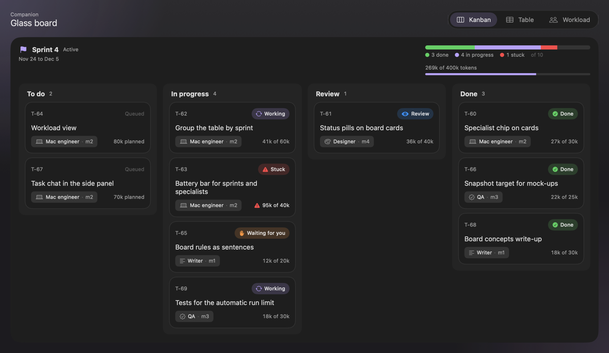
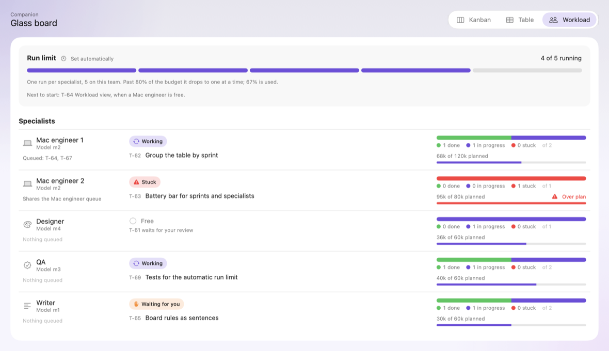

# Board concepts from monday.com, in Companion's glass style

Board task T-56 (role: designer). Design only: nothing here changes a production view under `apple/Sources/Companion/`. The mock-ups are standalone SwiftUI views with sample data in [`apple/Sources/CompanionSnapshots/Mockups/`](../../apple/Sources/CompanionSnapshots/Mockups/), and every picture below is rendered from them.

Team, role and sprint terms follow [ADR 0016](../adr/0016-board-team.md): a **Project Manager**, **Specialists** that each hold a **Role**, one run per specialist, **Team Size**. ADR 0016 is still Proposed, so its names (Project Manager, Specialist, the role titles) are proposals that the owner has not confirmed. The same goes for every new name a person would see here: the five state words, "Queued", "Not planned", "Run limit". The model names `m1` to `m4` are stand-ins, because names in the registry are the owner's to choose.

## Sources

Every source was read on 2026-11-25. Pages marked *read* were fetched, and their text was checked against what this doc says. Pages marked *listed* turned up only in monday's own help-center search, with a title and a short excerpt.

| # | Source | What it shows | |
| --- | --- | --- | --- |
| S1 | [The Status Column](https://support.monday.com/hc/en-us/articles/360001269685-The-Status-Column) | Status labels track whether work is not started, in progress or done. A board can have up to 40 labels, each with its own color. The gray default label is best left blank. | read |
| S2 | [Sprint management with monday dev](https://support.monday.com/hc/en-us/articles/360010646539-Sprint-management-with-monday-dev) | The Tasks board's groups are sprints: one group for the backlog of unassigned tasks and one for the current active sprint. There are also Sprints, Epics and a hidden Capacity board. | read |
| S3 | [monday dev](https://monday.com/dev) | Scrum and Kanban boards, sprint automations, capacity planning, burndown and velocity charts, AI sprint summaries. | read |
| S4 | [Sprint planning (blog)](https://monday.com/blog/rnd/sprint-planning/) | A sprint goal, a sprint backlog drawn from the product backlog, capacity and velocity, and a dashboard of backlog and capacity. | read |
| S5 | [The Battery Widget](https://support.monday.com/hc/en-us/articles/360002159360-The-Battery-Widget) | Overall progress in one glance, summed from the chosen status columns, with an optional weight so a large task counts for more. | read |
| S6 | [Resource management with Workload](https://support.monday.com/hc/en-us/articles/360010166559-Resource-management-with-Workload) | The Workload View shows "in one glance who is over their capacity" so upcoming tasks can be assigned to match. Capacity follows each team's work schedule. | read |
| S7 | [The Workload Widget](https://support.monday.com/hc/en-us/articles/360010699760-The-Workload-Widget) | Workload is available both as a board view and as a dashboard widget. | listed |
| S8 | [Workload management (blog)](https://monday.com/blog/project-management/workload-management/) | Capacity units per type of work, and teams running at "110% capacity" as the problem to make visible. | read |
| S9 | [The board views](https://support.monday.com/hc/en-us/articles/360001267945-The-board-views) | Several views over one board's data (Table, Kanban, Workload, Chart, Gantt, Calendar, Cards and more), switched from a menu or from tabs under the board's title. | read |
| S10 | [The Kanban View](https://support.monday.com/hc/en-us/articles/360000661379-The-Kanban-View) | A Kanban view whose columns come from a chosen Status column, set up from the view's settings. | read |
| S11 | [Kanban (features)](https://monday.com/features/kanban) | Drag and drop between statuses, "intuitive color-coding", custom groups and filters. | read |
| S12 | [The Dashboards](https://support.monday.com/hc/en-us/articles/360002187819-The-Dashboards) | Dashboards gather data from connected boards through widgets: more than 30 widget types, up to 30 widgets on a dashboard. | read |
| S13 | [Get started with monday automations](https://support.monday.com/hc/en-us/articles/360001222900-Get-started-with-monday-automations) | Automations are written as sentences: "When this happens", an optional condition, "then do this". The parts a person fills in are underlined. | read |
| S14 | [Status change automations](https://support.monday.com/hc/en-us/articles/360011528299-Status-change-automations) | A status change can start an action: a notification, a date change, a move to another group, another status. | read |
| S15 | [The Item Card](https://support.monday.com/hc/en-us/articles/360017143959-The-Item-Card) | A view inside the item page that brings one item's fields together, set as a tab beside Updates, Files and Activity Log. | read |
| S16 | [The item pop-up card](https://support.monday.com/hc/en-us/articles/360001568919-The-item-pop-up-card) | An item's details open over Kanban, Workload, Timeline and other views and can be edited there without leaving the view. | read |
| S17 | [The Updates Section](https://support.monday.com/hc/en-us/articles/115005900249-The-Updates-Section) | Each item's conversation (updates and replies), which AI can summarize. | listed |
| S18 | [Group your board by anything](https://support.monday.com/hc/en-us/articles/4452237638546-Group-your-board-by-anything) | Groups can be built from any column, not only by hand. | listed |

**What not to take from monday.** Its main table is a spreadsheet: a grid line around every cell, status shown as a fully filled, saturated cell, up to 40 label colors (S1), "color-coding" as the main signal (S11), and dense rows with many columns at once. Companion keeps the ideas and leaves that look behind. Rows have room and no grid lines. Five fixed state colors are used, each with a symbol and its word. Glass stays on the control layer only, and no surface has a drop shadow.

## The rules the mock-ups follow

- **Tokens only**, from [apple/Design/README.md](../../apple/Design/README.md): `Design.Space`, `Radius`, `TextRole` and `TextLevel`, `Tone`, `Fill`, `Control`, `Icon`, `glassToolbarGroup()` and `glassButton(_:)`. No literal colors, font sizes or spacing. A few layout widths (table columns, the side panel, the Workload meter) and the pill tint strength are not tokens yet. They are kept together in `MockMetrics` (`MockupComponents.swift`) so a later task can move the ones that prove right into `Tokens.swift`.
- **No drop shadows.** No view calls `shadow`. Depth comes from the three fills (content, raised, line) and from glass on the toolbar.
- **Purple primary.** The accent (`Design.Tone.accent`, the look's purple) marks the selected view, work that is moving, values a person can change in a rule, and the one prominent button.
- **Five fixed state colors**, and no others:

| State | Tone | Symbol | Why |
| --- | --- | --- | --- |
| Working | accent (purple) | arrows in a circle | the look's own color means work moving |
| Waiting for you | caution (orange) | raised hand | it needs the person |
| Review | info (blue) | eye | finished, being looked at |
| Stuck | critical (red) | triangle | over its estimate or failing checks |
| Done | positive (green) | check | merged |

- **Glass only on the control layer**: the view switcher, the panel's tabs and the buttons. Cards, rows, rules and chat messages sit on the content and raised fills, as the README requires. This is also why the task side panel is on the raised fill and not on glass: it holds a chat.

## The eight concepts

### 1. Status as a solid tinted pill

**From monday:** the Status column, with a colored label per state and a blank default (S1). Kanban columns are built from it (S10).

**In Companion:** each state is a capsule filled with its tone at a low strength. The symbol takes the full tone, and the word stays primary text, so it reads in light, dark and Increase Contrast and does not depend on color alone. A task that has not started has no pill, only quiet tertiary text ("Queued" in To do, "Not planned" in Backlog), just as monday recommends leaving the default label blank. The five states are finer than the board's five columns (`WorkStatus`): a task In progress can be Working, Waiting for you or Stuck. The pill is the state of its latest run, and the column is where the task stands.

### 2. Sprints as groups: the active sprint on top, the backlog below

**From monday:** monday dev's Tasks board has a group per sprint, with the active sprint and a backlog group (S2), plus planning against capacity (S3, S4) and grouping by any column (S18).

**In Companion:** the Table view is grouped by sprint. Sprint 4, marked Active with a purple flag, comes first, and the Backlog is under it. Each group's header carries its dates and its battery (concept 3). The backlog has no task battery, because nothing in it has started. It shows what is estimated and how many tasks have no estimate yet, since ADR 0016 never starts a task without one by itself.

### 3. A battery bar per sprint and per specialist

**From monday:** the Battery widget, overall progress summed from statuses and optionally weighted (S5).

**In Companion:** two thin bars instead of one many-colored battery. The **task battery** uses only three tones: done (positive), in progress (accent, counting Working, Waiting and Review) and stuck (critical). The empty part of the bar is what has not started, and a legend with counts follows. The **token meter** shows tokens used against the plan (for a sprint), the specialist's share of it (in Workload) or the estimate (for a task), and turns critical with "Over plan" or "Over estimate" once passed. Token weight replaces monday's optional weight, because tokens are what a run costs here.

### 4. Each card shows its specialist chip

**From monday:** cards in Kanban and the item card show an item's fields, its owner among them (S10, S15).

**In Companion:** each card shows its number, its state pill, a title of up to two lines, a **specialist chip** (role symbol, role, then model) and its tokens against the estimate. The chip is neutral (the line fill), so it never competes with the pill for color. A task with no role shows "Needs a role", ADR 0016's own marking.

### 5. Views over the same data: Kanban, Table grouped by sprint, Workload

**From monday:** several views over one board, switched from tabs under the title (S9). Kanban is built from a Status column (S10, S11), and Workload is one of the views (S7).

**In Companion:** one glass toolbar group, with Kanban, Table and Workload over the same sample tasks. Kanban shows the active sprint's To do, In progress, Review and Done with the sprint header above. Rather than scrolling out of sight, it wraps from four columns (wide) to two (regular) to one (compact). Table rows line up by column width alone, with no grid lines. At compact width each row becomes two lines. monday's dashboards (S12) are left out on purpose: the sprint header and Workload carry the few numbers a board needs, and a dashboard of up to 30 widgets is the dense look this design avoids.

### 6. Workload, with the automatic run limit visible

**From monday:** the Workload view shows who is over capacity, at a glance (S6, S7, S8).

**In Companion:** a **Run limit** card first. It has a seat per run the board allows, filled purple for each run going ("4 of 5 running"), and the rule that sets the limit in a sentence. Under it is a row per specialist: role, seat and model, what is queued for its role, the task it is running with its pill, its task battery, and its tokens against its share of the plan. Nothing in this repository describes T-52 yet, so the limit is drawn as ADR 0016 section 4 sets it: one run per specialist, at most Team Size, and one at a time across the team past 80 % of the budget. Queued work belongs to a role, not a person, because any free specialist of that role takes the next task. If T-52 sets the limit another way, only the sentence and the seat count change.

### 7. Board rules as plain sentences in Board Settings

**From monday:** automations as "When this happens, then do this" sentences with the parts to fill in underlined (S13), and status changes as triggers (S14).

**In Companion:** a Rules section in Board Settings, grouped into Runs, Review, and Budget and team. Each rule is one sentence, and the values a person can change are in purple semibold. Examples: "When a run passes **3x** its estimate, **stop it and re-plan**", "When a role has **3 tasks** waiting for me in Review, **start no more of its work**". The numbers are ADR 0016's `TeamRules` and `Overrun` thresholds. A rule kept in code, such as holding back work whose checks did not all pass (`Checks.letThrough`), shows a lock and "Always on" instead of a switch. That way the page never suggests it can be turned off. The Project Manager may suggest a rule, but only as advice: it needs the person's "Add this rule". A sentence is only how a rule is shown. Each one stays a constant with its tests in `apple/Shared/CompanionBoard`, never words in a prompt.

### 8. A task's chat in its side panel

**From monday:** an item opens over the board with its details and its Updates (S15, S16, S17).

**In Companion:** selecting a task opens a side panel beside the Table, and the row stays highlighted in purple. The board stays in view, and the window does not switch to another chat. The panel shows the task's title, state pill, specialist chip and token meter, then glass tabs (Chat, Details, Runs), then the task's **one chat** (`WorkItem.chat`). That chat holds every run divided by its own header, messages from the specialist and the Project Manager, and what the board itself did, set apart as notices ("this run passed 2x its estimate, so the Project Manager was asked whether to go on"). The message box at the bottom writes to that same chat. At compact width the panel takes the whole window, with a Board button to go back.

## Snapshots

Every mock-up is shown at the design system's three sample widths (`Design.WidthClass.sampleWidth`: compact 480, regular 800, wide 1180 points), in light and dark.

| Mock-up | Light | Dark |
| --- | --- | --- |
| Kanban | [compact](../../apple/Sources/CompanionSnapshots/Mockups/Snapshots/kanban-compact-light.png), [regular](../../apple/Sources/CompanionSnapshots/Mockups/Snapshots/kanban-regular-light.png), [wide](../../apple/Sources/CompanionSnapshots/Mockups/Snapshots/kanban-wide-light.png) | [compact](../../apple/Sources/CompanionSnapshots/Mockups/Snapshots/kanban-compact-dark.png), [regular](../../apple/Sources/CompanionSnapshots/Mockups/Snapshots/kanban-regular-dark.png), [wide](../../apple/Sources/CompanionSnapshots/Mockups/Snapshots/kanban-wide-dark.png) |
| Table grouped by sprint | [compact](../../apple/Sources/CompanionSnapshots/Mockups/Snapshots/table-compact-light.png), [regular](../../apple/Sources/CompanionSnapshots/Mockups/Snapshots/table-regular-light.png), [wide](../../apple/Sources/CompanionSnapshots/Mockups/Snapshots/table-wide-light.png) | [compact](../../apple/Sources/CompanionSnapshots/Mockups/Snapshots/table-compact-dark.png), [regular](../../apple/Sources/CompanionSnapshots/Mockups/Snapshots/table-regular-dark.png), [wide](../../apple/Sources/CompanionSnapshots/Mockups/Snapshots/table-wide-dark.png) |
| Workload | [compact](../../apple/Sources/CompanionSnapshots/Mockups/Snapshots/workload-compact-light.png), [regular](../../apple/Sources/CompanionSnapshots/Mockups/Snapshots/workload-regular-light.png), [wide](../../apple/Sources/CompanionSnapshots/Mockups/Snapshots/workload-wide-light.png) | [compact](../../apple/Sources/CompanionSnapshots/Mockups/Snapshots/workload-compact-dark.png), [regular](../../apple/Sources/CompanionSnapshots/Mockups/Snapshots/workload-regular-dark.png), [wide](../../apple/Sources/CompanionSnapshots/Mockups/Snapshots/workload-wide-dark.png) |
| Card, state pills, specialist chips | [compact](../../apple/Sources/CompanionSnapshots/Mockups/Snapshots/card-compact-light.png), [regular](../../apple/Sources/CompanionSnapshots/Mockups/Snapshots/card-regular-light.png), [wide](../../apple/Sources/CompanionSnapshots/Mockups/Snapshots/card-wide-light.png) | [compact](../../apple/Sources/CompanionSnapshots/Mockups/Snapshots/card-compact-dark.png), [regular](../../apple/Sources/CompanionSnapshots/Mockups/Snapshots/card-regular-dark.png), [wide](../../apple/Sources/CompanionSnapshots/Mockups/Snapshots/card-wide-dark.png) |
| Board Settings rules | [compact](../../apple/Sources/CompanionSnapshots/Mockups/Snapshots/rules-compact-light.png), [regular](../../apple/Sources/CompanionSnapshots/Mockups/Snapshots/rules-regular-light.png), [wide](../../apple/Sources/CompanionSnapshots/Mockups/Snapshots/rules-wide-light.png) | [compact](../../apple/Sources/CompanionSnapshots/Mockups/Snapshots/rules-compact-dark.png), [regular](../../apple/Sources/CompanionSnapshots/Mockups/Snapshots/rules-regular-dark.png), [wide](../../apple/Sources/CompanionSnapshots/Mockups/Snapshots/rules-wide-dark.png) |
| Task side panel with its chat | [compact](../../apple/Sources/CompanionSnapshots/Mockups/Snapshots/side-panel-compact-light.png), [regular](../../apple/Sources/CompanionSnapshots/Mockups/Snapshots/side-panel-regular-light.png), [wide](../../apple/Sources/CompanionSnapshots/Mockups/Snapshots/side-panel-wide-light.png) | [compact](../../apple/Sources/CompanionSnapshots/Mockups/Snapshots/side-panel-compact-dark.png), [regular](../../apple/Sources/CompanionSnapshots/Mockups/Snapshots/side-panel-regular-dark.png), [wide](../../apple/Sources/CompanionSnapshots/Mockups/Snapshots/side-panel-wide-dark.png) |

### How they are made

T-17's renderer, `apple/scripts/snapshots.sh`, is not on companion/main, and the only version in Git history captures the running app's panel, not standalone views. The owner approved rendering with `bash apple/Sources/CompanionSnapshots/Mockups/render.sh` instead on 2026-11-25. The script compiles the mock-ups together with `Tokens.swift`, `GlassSurfaces.swift`, `SizeRules.swift` and the shared `CompanionDesign` package, draws each view in a window that is never shown, and saves the pictures into `Snapshots/`. It belongs to no app target and changes nothing in the app. All 36 pictures were rendered with it on 2026-11-25 and each was looked at: nothing is clipped or overlapping at any width, in light or dark.

Two limits of rendering off screen:

- **Glass draws solid.** A window with no window server behind it draws no Liquid Glass, so the pictures use the design system's own Reduce Transparency look (solid with an edge). On screen, the view switcher and the panel tabs are Liquid Glass.
- **Capsule outlines** show a faint seam at each end in the pictures. This comes from drawing off screen, not from the design.

## Decisions and what is open

- Five state colors, mapped to existing tones. No new color token is needed.
- The pill tint strength (0.18) and the layout widths stay in `MockMetrics` until a real view uses them, and are then proposed as tokens.
- Token audit (2026-11-25): every color in the mock-ups is a `Design.Tone` or `Design.Fill`, every font a `TextRole` or `Icon`, every spacing and corner a `Design.Space` or `Radius`. No view calls `shadow`. The only values outside `apple/Design/` are the `MockMetrics` widths, the 0.18 tint, a 1 point line and the switch's 1.75 aspect, all kept in one place.
- Dashboards are not a fourth view. Their numbers live in the sprint header and Workload.
- Follow-up: once T-17's `snapshots.sh` is on companion/main and can render standalone views, move `MockupCatalog` into its target, re-render the 36 pictures with it and retire `render.sh`.
- Task titles in Table and Workload wrap to at most two lines and never end in an ellipsis, because the title is what a person scans for. Beside the side panel the table always uses stacked rows, since even a wide window leaves it under 800 points.
- Finding for the design system: in dark mode the solid prominent button (`borderedProminent`, used by `glassButton(.prominent)` under Reduce Transparency and in these pictures) puts white text on a pale purple fill ("Add this rule" in the rules pictures). Measured from the pictures on 2026-11-25: the dark fill is #C3B4FA, 1.87:1 against white, and the light fill is #7F6ADE, 4.18:1. Both are under the 4.5:1 that small text needs, and dark is far under it. It belongs to `GlassSurfaces.swift`, outside this task, so it is left for a design-system task: darken the dark fill or use dark text on it.
- Open: the owner confirms or renames the state words and ADR 0016's names. T-52's own rule for the run limit replaces the ADR 0016 reading used here.