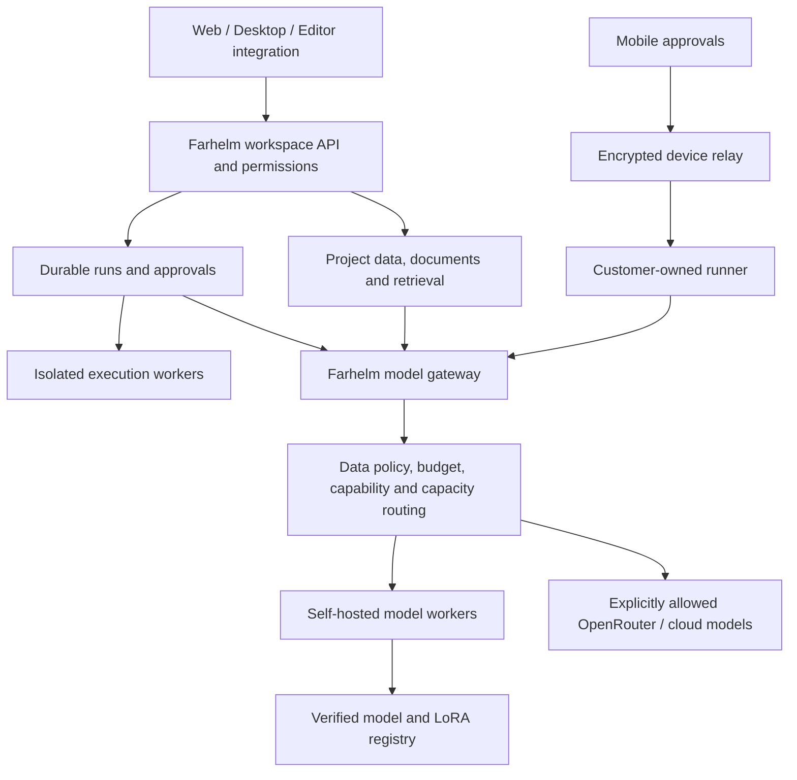

# Farhelm: project review and local AI platform plan

Research and code review date: October 22, 2026. This is a planning document; application code has not been changed.

Historical snapshot: foundation fixes implemented subsequently are recorded in
[ADR 0001](adr/0001-local-execution-boundaries.md). Findings below describe the
review date; consult that decision for current behavior and remaining limits.

## Recommendation

Build Farhelm into a **private AI workspace for small software teams**, combining conversations, repository work, supervised agents, documents and task management. Start with one complete workflow: a team discusses an issue, creates a task, an agent proposes and tests a change, a person reviews it, and the task records the result.

Farhelm already owns useful parts of this workflow. Keep its Rust runner, gateway, encrypted device transport, approval system, Git worktrees, diff review and shared clients. Extend them rather than replacing the project with several unrelated platforms.

Local models plus retrieval, tools, carefully chosen adapters and optional cloud inference can deliver valuable workflows. **Multiple LoRAs do not establish that a small model can do everything a frontier model does.** Treat each capability as a measurable product claim. New facts belong primarily in retrieval; tools supply actions; adapters specialize recurring behavior; larger models remain optional escalation paths. Image generation, transcription, speech synthesis and visual understanding need suitable models/tools, not just a text-model adapter.

Assumptions: an initial developer-team audience, web/desktop as primary surfaces, mobile as the approval companion, and hosted self-managed inference plus an optional customer-owned runner. Hardware and schedule below are proposed starting points, not measured Farhelm performance.

## 1. What exists today

| Area | Evidence in the repository | Assessment |
|---|---|---|
| Core architecture | Domain, application, SQLite, gateway, agent, cloud, relay and protocol crates | Good separation to preserve |
| Native agent | File/search/edit tools, command approval, Git worktree, diff review, merge/revert, repository notes, bounded sequential delegation | Useful coding foundation; execution containment needs work |
| Cost gateway | Task routing, budgets, retrieval, compaction, caching, batching and ledger | Extend into a provider-neutral inference layer |
| Local inference | `CONSCIOUS_API_URL`, `CONSCIOUS_API_KEY`, `CONSCIOUS_MODEL` in `dispatch.rs` | Real integration exists, through an Anthropic Messages-compatible gateway |
| Cloud and transport | Accounts, organizations, roles, devices, enrollment, billing, encrypted relay | Preserve; strengthen authorization within shared runners |
| Clients | Web fleet/session/task review/cost/account views; mobile approvals/review; Tauri desktop; Swift watch | More mature as supervision clients than as a general workspace |
| Work management | Coding task and review records | General projects, boards, assignments, dependencies and durable automations still need design |
| Training and model operations | No native training pipeline, adapter registry or GPU scheduler found in inspected code | Add after establishing a measured baseline |

Important distinction: Farhelm selects model names on one backend client. Conscious could perform richer routing internally, but that implementation is outside this repository. Do not describe Farhelm as lacking local support, or assume it already implements independent local/OpenRouter routing.

## 2. Existing issues and service release gates

These are findings verified by reading the code, not reproduced exploit demonstrations. Bugs and missing service capabilities are distinguished below. Existing passing tests do not establish these missing guarantees.

| Priority / type | Finding and evidence | Required change |
|---|---|---|
| P1 bug | New files can escape the workspace through a directory symlink. [workspace.rs:137](/Users/harshsah/Project/farhelm/crates/farhelm-agent/src/workspace.rs:137) checks canonical containment only if the full target exists; [write at :218](/Users/harshsah/Project/farhelm/crates/farhelm-agent/src/workspace.rs:218) follows existing parents. `link/new.txt`, with `link` pointing outside and a missing leaf, bypasses the check. | Check existing ancestors and use directory-relative/no-follow operations that also address replacement races. |
| P1 execution-policy gap | The gateway runs repository checks before agent shell approvals: [pipeline.rs:485](/Users/harshsah/Project/farhelm/crates/farhelm-gateway/src/pipeline.rs:485), [pregate.rs:240](/Users/harshsah/Project/farhelm/crates/farhelm-gateway/src/pregate.rs:240). Cargo tests/build scripts and pytest execute repository-controlled code on the host with inherited environment. The first pass receives the original repository, not the task checkout. | One execution policy for prechecks and agent commands. Explicit repository trust locally; isolated workers for untrusted hosted repositories. Worktrees isolate edits, not host privileges. |
| P1 bug | Shell timeout reports that the command was killed but wraps `Command::output()` without explicit termination or `kill_on_drop`: [tools.rs:417](/Users/harshsah/Project/farhelm/crates/farhelm-agent/src/tools.rs:417). Output is collected fully before truncation. | Terminate the process group and descendants; handle cancellation; stream into bounded capture buffers. |
| P1 packaging bug | Desktop serves CWD-relative `web/dist` at [main.rs:170](/Users/harshsah/Project/farhelm/desktop/src-tauri/src/main.rs:170), then opens its HTTP URL. Embedded `frontendDist` is not used by that router. Launching an installed bundle outside the checkout will generally lack the page. | Serve embedded assets or resolve bundled resources; test a packaged launch outside the repository. |
| P2 verification bug | A missing check executable becomes `passed = true` at [pregate.rs:258](/Users/harshsah/Project/farhelm/crates/farhelm-gateway/src/pregate.rs:258); the report remains non-skipped. A verify-only request can then claim success with no actual checks. | Represent passed/failed/skipped separately and require successful execution of required checks. |
| P2 prompt bug | [task.rs:58](/Users/harshsah/Project/farhelm/crates/farhelm-agent/src/task.rs:58) tells the agent that tests cannot see its staged edits. Actual tools now edit and execute in a Git worktree. | Update system/delegation prompts and documentation to match the implemented behavior. |
| P2 client bugs | Mobile swallows device registration failure and saves an empty device ID: [App.tsx:316](/Users/harshsah/Project/farhelm/mobile/src/App.tsx:316). Some fetch failures also disappear. Legacy phone/watch pairing asks for a LAN runner, while the runner binds loopback. | Visible registration/error recovery; deterministic resource errors; authenticated relay-compatible enrollment. Do not fix pairing by exposing the whole local API. |
| Service capability | Native provider routing uses one `AnthropicClient`, [main.rs:740](/Users/harshsah/Project/farhelm/crates/farhelm-runner/src/main.rs:740); live completion calls use `/v1/messages`, [dispatch.rs:612](/Users/harshsah/Project/farhelm/crates/farhelm-gateway/src/dispatch.rs:612). Optional `CONSCIOUS_MODEL` overrides all tiers. | Provider/model registry and normalized streaming/tool protocols, with tested OpenAI-compatible and OpenRouter adapters. |
| Service capability | Jobs are detached futures, [task.rs:477](/Users/harshsah/Project/farhelm/crates/farhelm-runner/src/task.rs:477); restart marks running jobs failed at `:497`. Git work may survive, but execution is not checkpointed. | Persistent steps, worktree reference saved before execution, leases, idempotency, cancellation and controlled recovery. |
| Shared-runner release gate | Cloud roles exist, but [commands.rs:119](/Users/harshsah/Project/farhelm/crates/farhelm-runner/src/commands.rs:119) receives the command and source surface (`DecidedVia`), without an account/project authorization principal. | Project-scoped principals, repository allowlists and resource authorization for every command. Required before sharing runners among users. |
| Accounting limitation | [price.rs:139](/Users/harshsah/Project/farhelm/crates/farhelm-domain/src/price.rs:139) records local usage at zero provider price. | Keep provider spend separate from GPU/runtime cost, queue time, storage and per-tenant compute quotas. |

Additional behavior to address for an IDE experience: worktrees start from committed HEAD and omit uncommitted user changes. Define an explicit snapshot policy for “continue my current edits.” Tool calls/results are partly rendered as text in the agent history; test real multi-turn tool reliability before standardizing this representation across providers.

## 3. A coherent product scope

Use one shared object model: **Workspace → Project → Conversation / Task / Document / Artifact**, with links between objects, members and permissions. Runs, approvals, tools and model versions should be attached to these objects rather than becoming separate products.

| Inspiration | First Farhelm behavior | Later expansion |
|---|---|---|
| ChatGPT / Claude / Gemini | Streaming conversations, attachments, model selection, document questions with source citations | Voice, richer multimodal artifacts and broader research |
| Cursor | Repository context, reviewed edits, test output, editor integration | Completion and deeper IDE features if customers need them |
| Devin | Task → plan → isolated execution → tests → reviewable change → human decision | Longer workflows and parallel execution after recovery works |
| Macro | `@` links among conversations, documents, tasks and shared project context | Email, collaborative editing and other workspace surfaces |
| monday.com | Board/list views, assignee, status, due date, comments, dependencies | Complex dashboards and automation builder |

Suggested first paid workflow: “Turn this bug discussion into a tracked task, implement it in this repository, show the tests and diff, obtain review, and update the task.” This uses existing Farhelm strengths and has a clear completion criterion.

## 4. Proposed architecture

This is a logical target, not the current deployed topology. Preserve two explicit deployment modes:

- **Customer-owned runner:** repository storage and execution remain on the customer's machine; selected prompt/context data leave it only when workspace inference policy permits. Fully local processing also requires customer-owned inference. Preserve the existing encrypted transport design.
- **Managed private inference:** models run on infrastructure you operate. It is self-hosted inference, but the service necessarily processes plaintext at the inference boundary. Define that trust boundary honestly rather than carrying over an “operator cannot read content” claim from the relay.

Keep SQLite for local runner state. Add Postgres for shared workspace entities and durable job coordination when introducing the hosted workspace; start retrieval with text search, then benchmark embeddings/reranking and optionally [pgvector](https://github.com/pgvector/pgvector). Keep document blobs in object storage. Filter retrieval by permissions before returning chunks, and preserve source identity/version for citations and deletion.

Begin with durable database jobs, leases and explicit state transitions. Evaluate [Temporal](https://github.com/temporalio/temporal), an MIT-licensed durable execution platform, when retry/wait/scheduling complexity justifies its operational cost. A workflow system still needs idempotent side effects; replay must not duplicate external actions.

Use a provider-independent conversation contract that preserves structured tool calls/results, errors, usage and streaming events. Model registry entries should include backend, model revision, tokenizer/template, modalities, tool/JSON support, usable context limit, quantization, adapter/base compatibility, memory requirement, prices and allowed data policies.

Routing order: enforce tenant policy → filter compatible models → check capacity/budget → choose a measured candidate → bounded retry/escalation. Model self-reported confidence should not authorize cloud fallback. Local-only requests must fail or wait if local capacity is unavailable. Never replay side-effecting tools just because generation retries.

## 5. Local models and fine-tuning

Recommended runtime split:

- Development: **Ollama or llama.cpp**, choose one initially. [Ollama](https://docs.ollama.com/api/openai-compatibility) provides OpenAI compatibility for supported APIs; [llama.cpp](https://github.com/ggml-org/llama.cpp/blob/master/tools/server/README.md) provides quantized serving and LoRA selection. Keep inference endpoints private behind Farhelm's authentication.
- Shared GPU inference: **vLLM**, with explicit tests of the chosen model, quantization, tool parser and LoRA combination. Its [LoRA support](https://docs.vllm.ai/en/stable/features/lora/) exposes adapters as model choices. Dynamic adapter administration belongs on a trusted internal network, never a tenant-controlled download endpoint.
- Alternative: [SGLang](https://docs.sglang.io/docs/advanced_features/lora) if benchmarking identifies an advantage; deploying both initially adds maintenance without established benefit.
- Training: [PEFT QLoRA](https://huggingface.co/docs/peft/developer_guides/quantization) with [Axolotl](https://docs.axolotl.ai/docs/getting-started.html) or [Unsloth core](https://github.com/unslothai/unsloth#license). Unsloth's optional Studio UI has AGPL licensing; distinguish it from the Apache-licensed core.

Use a reproducible coding baseline such as [Qwen3-Coder-30B-A3B-Instruct](https://huggingface.co/Qwen/Qwen3-Coder-30B-A3B-Instruct), whose card lists Apache 2.0 and 30.5B total / 3.3B active parameters. Compare a smaller general/vision model such as [Qwen3.5-9B](https://huggingface.co/Qwen/Qwen3.5-9B), and a current larger challenger such as [Qwen3.8-27B](https://huggingface.co/Qwen/Qwen3.8-27B). These are candidates, not a claim that one is best for Farhelm. Pin exact revisions and evaluate them on your workflows.

MoE active parameters describe computation, not resident model size. The [80B-total Coder-Next](https://huggingface.co/Qwen/Qwen3-Coder-Next) is not a 3B-memory model merely because it activates about 3B parameters.

Recommended customization sequence:

1. Measure the base model with a good prompt and structured tools.
2. Add permission-aware retrieval for repository and project facts.
3. Identify repeated failures that a schema, better tool or deterministic code cannot solve.
4. Train **one** tool-protocol or editing adapter, using held-out tasks from different repositories.
5. Compare quality, unsafe actions, latency and cost with the unchanged baseline; roll back on regressions.
6. Add further adapters only when evidence supports specialization.

An adapter should have a base/checkpoint/tokenizer hash, training-data manifest, license record, eval report, owner and rollback version. Do not arbitrarily stack adapters and assume their improvements compose. Keep tenant adapters isolated. Train using supported training weights and formats, then export the tested deployment format; a downloaded GGUF is not automatically a QLoRA training input ([Axolotl matrix](https://docs.axolotl.ai/docs/support-matrix.html)).

## 6. Hardware for development and scale

Prefer rented capacity until quality and concurrency have been measured. The proposed pilot benchmark is 5–10 simultaneous model requests, 8K–16K input contexts and roughly 1K output tokens. It is a load-test scenario, not a capacity promise. Start production contexts conservatively rather than enabling a model card's maximum context for every request.

| Stage | Proposed configuration | Purpose |
|---|---|---|
| Development | Existing 64GB+ Apple Silicon machine for local prototyping, or Linux with one 32GB CUDA GPU, 128GB RAM and 2TB NVMe | One main model resident at a time; prompt/tool development. Avoid a new workstation purchase before validating the workload. |
| Pilot | Rent one 48GB GPU and compare with a 96GB GPU; 128–256GB host RAM as a starting configuration | Measure quantized coding model, small model, context/concurrency tradeoffs, adapter overhead and tail latency. Keep training separate. |
| Production | At least two inference workers on separate hosts, sized from the pilot; separate API/data/jobs/sandbox workloads | Survive one inference-host failure, isolate workloads and scale replicas by active requests and queue delay. |
| Larger models/training | Rent larger-memory workers when justified; dedicated training jobs | Test bigger models, longer contexts or training without disrupting customer inference. |

Verified capacity examples are [RTX 5090: 32GB](https://www.nvidia.com/en-us/geforce/graphics-cards/50-series/rtx-5090/), [L40S: 48GB](https://www.nvidia.com/en-us/data-center/l40s/), [RTX PRO 6000 Blackwell: 96GB](https://www.nvidia.com/content/dam/en-zz/Solutions/data-center/rtx-pro-6000-blackwell-workstation-edition/workstation-blackwell-rtx-pro-6000-workstation-edition-nvidia-us-3519208-web.pdf), and [H200: 141GB](https://www.nvidia.com/en-us/data-center/h200/). These establish specifications, not purchase economics or Farhelm throughput. Verify runtime/model support on the rental hardware.

Derived illustration: 30.5B parameters × 4 bits ÷ 8 is about **15.25GB of raw parameter payload**; 80B is about 40GB. Actual memory is larger due to quantization metadata, unquantized layers, adapters, KV/state caches, runtime workspaces and concurrency. Vision encoders can add more. Training memory is a separate calculation. Two GPUs do not automatically form one unified memory pool.

Scale small/interactive and coding/long-running requests in separate pools when measurements justify it. Track queue delay, time to first token, completion latency, active sequences, cache occupancy, GPU memory, cancellations and cost per successful task. Registered user count is not a capacity metric.

## 7. Relevant datasets

Start with a curated tool dataset plus your own consented task trajectories. A public card's license label is useful evidence but does not automatically clear all underlying repositories, teacher outputs or personal data. Record exact revisions, attribution, source restrictions and allowed uses before training a distributed commercial checkpoint.

| Dataset | Recommended use | License/provenance considerations |
|---|---|---|
| [Salesforce xLAM function-calling 60k](https://huggingface.co/datasets/Salesforce/xlam-function-calling-60k) | First tool-calling adapter: function choice, schemas and arguments | Card lists CC BY 4.0. Synthetic examples use DeepSeek-V2-Chat and Mixtral-8x22B-Instruct. Preserve attribution and teacher lineage; this is not a full repository-agent dataset. |
| [Nous Hermes function-calling v1](https://huggingface.co/datasets/NousResearch/hermes-function-calling-v1) | Secondary tool/JSON and multi-turn candidate | Card lists Apache 2.0 and includes a cleaned Glaive component. Full teacher lineage is not disclosed on the inspected card; review provenance before selecting it. |
| [HuggingFace SmolTalk](https://huggingface.co/datasets/HuggingFaceTB/smoltalk) | Selected summarization, rewriting and instruction subsets | Newly generated subsets are Apache 2.0; the complete mixture retains component licenses. Main Magpie generation uses Llama 3.1; [its license](https://huggingface.co/meta-llama/Llama-3.1-405B-Instruct/blob/main/LICENSE) contains naming requirements for made-available models improved with its outputs. Do not label the entire mixture uniformly cleared. |
| [NVIDIA OpenCodeReasoning](https://huggingface.co/datasets/nvidia/OpenCodeReasoning) | Later coding-reasoning experiments | CC BY 4.0 card; R1-generated reasoning over competitive-programming questions with source/license fields. Review question-source rights. Competitive coding does not teach Farhelm's edit/review/sandbox workflow by itself. |
| [SWE-bench Verified](https://huggingface.co/datasets/princeton-nlp/SWE-bench_Verified) | Evaluation of real repository issue resolution | 500 validated test examples. MIT harness licensing does not relicense upstream repositories or establish a blanket dataset license. Keep reference fixes outside training and retrieval. |
| [BEIR HotpotQA](https://huggingface.co/datasets/BeIR/hotpotqa) | Initial retrieval/evidence evaluation | Card lists CC BY-SA 4.0. The BEIR framework's Apache license does not replace dataset/source terms. Keep as evaluation material initially. |

Do not begin with [StarCoderData](https://huggingface.co/datasets/bigcode/starcoderdata): its roughly 250B-token corpus and per-repository provenance make it a continued-pretraining project, far beyond the first adapter experiment.

Build the proprietary dataset from opt-in Farhelm runs: intent → retrieved context identifiers → tool arguments → actual tool results → corrections → final diff/artifact → checks → human approval/rejection. Remove secrets and personal data, honor deletion, separate tenants, and label unsafe/failed attempts as negatives. A test passing alone does not make a trajectory a high-quality demonstration.

Initial experiment proposal: curate 2,000–5,000 suitable examples, inspect a sample manually, add real Farhelm protocol examples, and keep an untouched repository-separated evaluation set. This is an experimental budget, not a known minimum for success. Use larger public corpora only after the first ablation shows useful improvement.

## 8. Projects to reuse, integrate or study

| Project | Role in Farhelm | Recommendation / boundary |
|---|---|---|
| [Macro](https://github.com/macro-inc/macro) | Linked team context across docs, chat and tasks; also Rust/TypeScript | Strong design reference. AGPL-3.0; compatible commercial use is possible, but closed-source reuse needs an appropriate licensing strategy. Macro offers alternative licensing discussions. |
| [LibreChat](https://github.com/LibreChat-AI/LibreChat) | Chat, model/provider selection, attachments and agents | MIT candidate for selective reuse or an evaluation prototype. Integrating its full application means a second backend/data model; prefer a short comparison before adopting it wholesale. |
| [AnythingLLM](https://github.com/Mintplex-Labs/anything-llm) | Local document chat and multi-user retrieval UX | MIT; useful reference or pilot baseline. Avoid operating two permanent user-facing chat products. |
| [OpenHands SDK](https://github.com/OpenHands/software-agent-sdk) | Devin-style coding execution, workspaces and event APIs | MIT core SDK. Compare against Farhelm's existing agent on identical tasks; integrate through an adapter if it wins. Account for its Python server/runtime, rather than replacing Rust silently. Enterprise components elsewhere have separate terms. |
| [Cline](https://github.com/cline/cline) | IDE/CLI client and local/OpenRouter integration patterns | Apache 2.0; evaluate as an editor integration before creating a standalone IDE fork. Its documented local/provider support demonstrates the general pattern is practical. |
| [Activepieces](https://github.com/activepieces/activepieces) | Business connectors and workflow integrations | Community Edition is MIT; enterprise features have commercial terms. Integrate selected connectors/workflows behind Farhelm's authorization. |
| [Langfuse](https://github.com/langfuse/langfuse) | Traces, prompt versions, datasets and evaluation | MIT except enterprise folders. Self-host with redaction/retention suited to private workloads; do not export local-only content to external telemetry. |
| [Playwright](https://github.com/microsoft/playwright), [Browser Use](https://github.com/browser-use/browser-use) | Deterministic browser tools and later browser agents | Playwright for controlled browser workflows; Browser Use is MIT and supports local inference. Treat browser execution as a permissioned worker with scoped credentials. |
| [LiteLLM](https://docs.litellm.ai/docs/) | Optional provider normalization and fallback | Useful if maintaining many providers becomes expensive. Farhelm already has a gateway: keep one authoritative policy/budget layer and avoid conflicting retry/accounting rules. |
| [Temporal](https://github.com/temporalio/temporal) | Durable long-running automation | MIT; defer until workflow complexity earns the extra service. |

Other licensing/maintenance findings that change selection:

- [Continue's repository](https://github.com/continuedev/continue) currently says it is read-only and no longer actively maintained. It remains an Apache-licensed design reference, but should not be the default maintained dependency for a new product.
- [Open WebUI](https://docs.openwebui.com/license/) has branding conditions in current versions. Do not assume a free large-scale white-label fork.
- [Dify's license](https://github.com/langgenius/dify/blob/main/LICENSE) restricts multi-tenant operation without written authorization and has frontend branding conditions.
- [n8n's license](https://github.com/n8n-io/n8n/blob/master/LICENSE.md) limits the standard grant to internal business/noncommercial uses. Product embedding or resale needs an appropriate agreement.

These are selection flags, not a blanket legal clearance. Inspect the exact version and component intended for shipping.

## 9. OpenRouter and free models

Use OpenRouter as an optional provider with an explicit workspace policy, provider allowlist, budget cap and visible actual backend/model. The official [free-model limits](https://openrouter.ai/docs/api_reference/limits) currently specify 20 requests/minute and 50 requests/day below the lifetime purchase threshold, or 1,000/day after at least $10 in credits has been purchased. Discover current availability and account limits rather than baking these values into product promises.

OpenRouter free capacity is suitable for development and best-effort experimentation. It is not a basis for guaranteed paid-service capacity. Downstream providers have their own [logging/training/retention policies](https://openrouter.ai/docs/guides/privacy/provider-logging); configure allowed handling for both paid and free routes. Local-only must never silently become free-cloud fallback.

If “free LLM package” means [gpt4free/g4f](https://github.com/xtekky/gpt4free), exclude it from the commercial reliability path. Some integrations depend on browser cookies/HAR data and provider behavior, and its [GPLv3 software license](https://github.com/xtekky/gpt4free/blob/main/LICENSE) does not grant rights to resell upstream services. Use authorized free API tiers or your own local inference instead.

## 10. Evaluation and release evidence

Create a Farhelm-specific suite before fine-tuning. Suggested initial 100 cases: 30 repository changes, 25 tool/permission cases, 20 document/citation cases, 15 task/automation workflows and 10 recovery/privacy cases. Include previously unseen repositories and adversarial documents. This proposed suite is a start, not sufficient proof of general safety.

Compare: base model + prompt, base + retrieval, base + adapter, and explicitly allowed cloud escalation. Hold prompts/tools/context settings fixed where possible. Evaluate the exact deployed quantization and adapter combination.

Measure completed workflow success, correct tool arguments, unwanted side effects, authorization failures, citation correctness, review acceptance, recovery after worker failure, latency and cost per successful result. A larger model judging a diff is useful feedback, but cannot substitute for tests or an isolated execution boundary. Official [OpenAI agent evaluation guidance](https://developers.openai.com/api/docs/guides/agent-evals) similarly emphasizes inspecting complete traces and then using repeatable datasets; this pattern does not require OpenAI inference.

Observed checks for this review:

- `cargo test -p farhelm-agent -p farhelm-gateway -p farhelm-runner --lib --tests`: passed.
- `pnpm -r typecheck`: passed.
- `pnpm -r test`: 231 passed, 6 live tests skipped.
- `pnpm --filter @farhelm/web build`: passed.

Scope limits: this was not the full Rust workspace/release matrix. No real model task, GPU benchmark, packaged-app launch, browser visual QA or native-device test was performed. The README itself says the model loop has only used scripted providers; that claim was not independently disproved here. CI should start deterministic runner/relay fixtures so the currently skipped live tests actually execute, and add packaged desktop plus browser/user-flow tests.

## 11. Delivery plan

Indicative 12-week pilot plan for roughly 2–3 focused engineers, with scope held to the first workflow. A solo build or the full multi-product vision will take longer; gate progress on evidence rather than calendar dates.

| Phase | Work | Exit evidence |
|---|---|---|
| Weeks 1–2: dependable foundation | Containment, command lifecycle, precheck trust policy, truthful checks/prompts, desktop asset packaging | Regression tests; installed desktop loads outside checkout; timeout/cancellation clean up descendants |
| Weeks 3–4: real local inference | Provider contract/registry, existing Conscious adapter, OpenAI-compatible adapter, streaming, tool protocol; optional OpenRouter policy | A real local task produces a correct tested diff; mixed backends work; local-only never contacts cloud |
| Weeks 5–6: workspace pilot | Projects, conversations, task board, file attachments, linked artifacts and scoped permissions. Use trusted customer-owned execution until hosted isolation and scoped runner authorization pass their release gates. | End-to-end issue discussion → agent change → review → task update; authorization tests |
| Weeks 7–8: reliable work | Checkpointed steps, leases, idempotency, retry/cancel, sandboxed hosted execution, retrieval with citations | Worker crash/restart and permission failures recover without duplicated side effects |
| Weeks 9–10: measured specialization | Dataset manifests, base/prompt/RAG comparison, one QLoRA, adapter registry, trace evaluation | Held-out improvement on target behavior without unacceptable regressions; documented rollback |
| Weeks 11–12: paid pilot readiness | GPU load tests/replicas, quotas, compute accounting, backups, deployment and enrollment QA | Measured SLO/capacity; one-host failure exercise; restore test; clear usage limits and support process |

Defer: a full IDE fork, full CRM/email suite, many simultaneous adapters, public adapter marketplace, watch distribution work and unrestricted autonomous computer operation. Add them when a paid workflow demonstrates demand and the execution/permission model supports them.

## 12. First engineering tickets and acceptance criteria

1. **Workspace containment.** Reject new files under external/dangling symlinks and path replacement races while retaining normal nested creation.
2. **Unified command policy.** Run prechecks and agent commands in the task checkout under applicable repository trust/approval; hosted untrusted code cannot read host secrets or mutate the original checkout.
3. **Process lifecycle.** Timeout/cancel terminate descendants, release the run slot and bound log memory; user-facing cleanup messages are accurate.
4. **Truthful verification.** Missing tools cannot yield “all green”; instructions match worktree behavior; an integration test executes against edited files.
5. **Desktop packaging.** Build/install/launch from an unrelated directory; `/` and assets load and the runner API connects.
6. **Provider registry.** Distinct local/cloud backends coexist; structured multi-turn tools round-trip; policy blocks forbidden fallback; usage records actual provider/model/adapter.
7. **Durable run state.** Save worktree and step references before execution; recover after process death without duplicating a completed action.
8. **Scoped runner authorization.** Carry account/project principals into commands; deny cross-project reads, approvals and repository paths.
9. **Workspace vertical slice.** Create a project/conversation/task and attach a reviewed change and test artifacts with shared history.
10. **Model quality and data pipeline.** Establish baseline evals and provenance manifests before training; accept an adapter only after controlled comparison.

Commercial packaging should charge for a coherent workspace and dependable execution, with compute quotas and optional BYOK/private-runner modes. Model unit economics as `(inference + idle capacity + sandbox runtime + storage + external APIs + operations) / successful workflows`, not “local token price = $0.” Start pricing only after the pilot reveals real usage and review burden.
