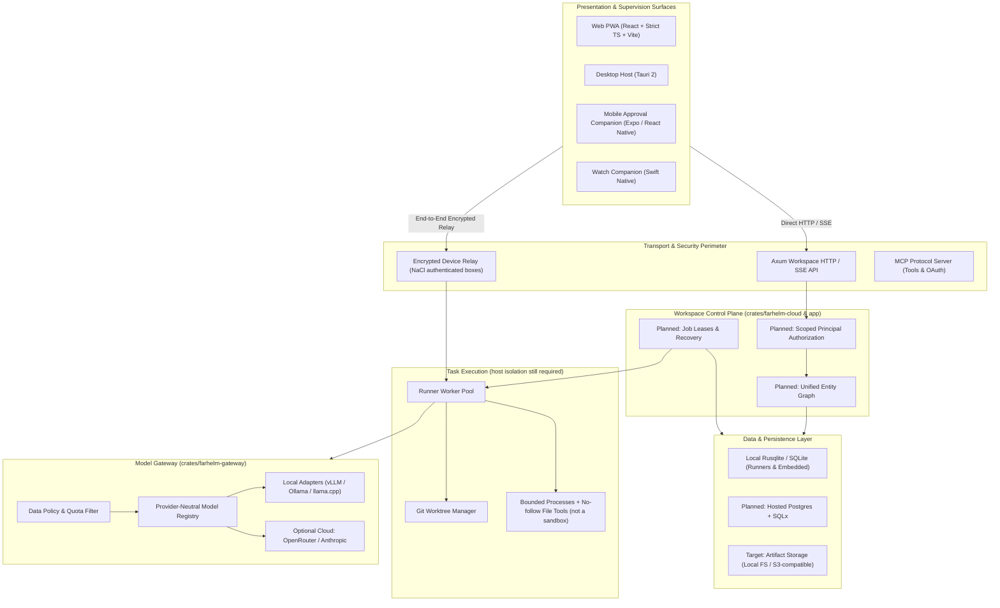
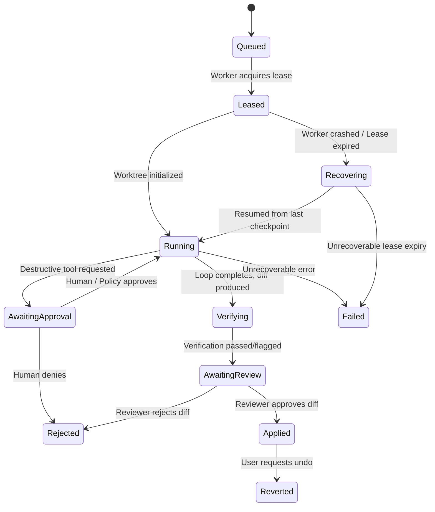

# Farhelm System Architecture Specification

**Status**: Target architecture, with implementation status called out below  
**Last Updated**: October 25, 2026  
**Primary Reference**: [AGENTS.md](../AGENTS.md) | [Engineering Stack](engineering-stack.md) | [Platform Review](platform-review-2026-10-22.md)  
**Associated ADRs**:

- [ADR 0001: Local Execution Boundaries](adr/0001-local-execution-boundaries.md)
- [ADR 0002: Unified Workspace Object Model & Cross-Entity Graph](adr/0002-unified-workspace-object-model.md)
- [ADR 0003: Provider-Neutral Inference Layer & Model Registry](adr/0003-provider-neutral-inference-layer.md)
- [ADR 0004: Durable Task Execution, Leased State Machine & Recovery](adr/0004-durable-task-execution-and-recovery.md)
- [ADR 0005: Scoped Principal Authorization & Capability Sandboxing](adr/0005-scoped-principal-authorization.md)
- [ADR 0006: Configured Model Routing](adr/0006-configurable-model-providers.md)
- [ADR 0007: Local Project API and Stable Workspace Scope](adr/0007-local-project-api.md)
- [ADR 0008: Project-Owned Local Agent Runs](adr/0008-project-agent-workflow.md)

This document preserves the parallel architectural proposal as the product's direction. See the [engineering guide](engineering-stack.md) for the current implementation inventory. [ADR 0001](adr/0001-local-execution-boundaries.md) describes the completed execution foundation, [ADR 0006](adr/0006-configurable-model-providers.md) describes the first configured-provider slice, and [ADR 0007](adr/0007-local-project-api.md) describes the local project create/list/detail API and UI. [ADR 0008](adr/0008-project-agent-workflow.md) connects registered repositories and project-owned agent runs through scoped review/apply/revert. Workspace DTOs, SQLite storage and deterministic authorization/recovery helpers exist; the broader linked-workspace API, runtime lease recovery and unified resource authorization remain planned, along with shared Postgres and a hosted command sandbox. Code examples and SQL below are design sketches, not applied migrations or installed APIs.

---

## 1. Executive Summary & Design Principles

Farhelm's goal is a commercial, private, local-first AI workspace combining conversational and multimodal assistance, contextual coding, supervised agents, linked documents and work management. Developer teams are the initial audience for the discussion → task → implementation/tests → diff review → task update workflow. The broader platform is not restricted to software engineering.

### Core Architecture Axioms

1. **Local-First & Data Sovereignty**:
   Inference, code indexing, and tool execution should prioritize local hardware and customer-owned runners. Optional cloud inference must follow explicit data policy. The initial configured gateway enforces `local_only` against its operator-declared provider routes; this is not a cryptographic guarantee or an operating-system egress sandbox. A loopback/private endpoint can itself proxy to a cloud service, so deployment owners must verify the runtime and model. Persisted per-workspace policy and stronger hosted egress controls remain planned.

2. **Unified Relational Entity Graph**:
   Work does not exist in silos. Discussions produce tasks; tasks spawn autonomous agent runs; runs produce code diffs and test artifacts; documents reference tasks and conversations via first-class typed edges (`@` mentions and bidirectional relations).

3. **Durable, Resumable Execution**:
   Long-running jobs should gain persisted state, leases and checkpoints. Record action intent before execution and record the result afterward; a database write cannot atomically cover an arbitrary external side effect. Resume only when reconciliation proves it safe, and surface uncertain outcomes. The current runner marks interrupted running tasks as failed on restart; resumable execution is future work.

4. **Strict Authorization & Least Privilege**:
   Model output and connector descriptions must never grant execution authority. The target is authenticated resource-scoped authorization across HTTP, relay, MCP and background work. The proposed `Principal` and execution permission types are not yet a unified implemented boundary; existing pairing, tokens and approval controls must be preserved during that migration.

5. **Split Economics (Tokens vs. Compute)**:
   Local inference consumes hardware and capacity. The gateway currently records provider token cost estimates; local token fees are zero. Separate compute, memory and capacity accounting is a planned measurement layer, not an implemented ledger feature.

---

## 2. High-Level System Architecture



The existing relay uses X25519 key agreement with XSalsa20-Poly1305 authenticated encryption (`crypto_box`), not Noise. Control-plane token signatures use ES256/P-256. These transport primitives do not establish the future per-project execution permissions.

---

## 3. Unified Entity Model & Relational Graph

### 3.1 Object Hierarchy

The target containment model is:

```text
Workspace (Tenant / Organization boundary)
 └── Project (Repository set, team scope, budget pool)
      ├── Conversation (Chat threads, multi-agent discussions, reviews)
      ├── Task (Tracked work item, status, priority, plan steps)
      │    └── TaskRun (Durable agent execution attempt, worktree, checkpoints)
      ├── Document (PRDs, architectural specs, notes, meeting logs)
      └── Artifact (Diffs, test reports, build binaries, compiler logs)
```

### 3.2 Relational Entity Graph (`entity_links`)

Inspired by Macro's deep-linking model, any entity can reference another through typed edges:

```text
+-------------------+       references       +--------------------+
|   Conversation    | ---------------------> |      Document      |
+-------------------+                        +--------------------+
         |                                              ^
         | spawns                                       | documents
         v                                              |
+-------------------+       generates        +--------------------+
|       Task        | ---------------------> |      Artifact      |
+-------------------+                        +--------------------+
         |                                              ^
         | executes via                                 | output
         v                                              |
+-------------------+                                   |
|      TaskRun      | ----------------------------------+
+-------------------+
```

#### Conceptual Storage Schema (not an applied migration)

Names and columns below illustrate the relationships. Existing local and cloud tables must be reconciled before writing append-only migrations; `CREATE TABLE IF NOT EXISTS` is not a migration strategy for an incompatible existing `tasks` or `workspaces` table. Hosted Postgres also requires an explicit async storage boundary. The linking table needs tenant scope, checked entity kinds and same-tenant referential integrity (for example, through a shared entity registry or equivalent transactional constraints); the polymorphic IDs below do not enforce those invariants themselves.

```sql
-- Workspaces
CREATE TABLE IF NOT EXISTS workspaces (
    id TEXT PRIMARY KEY,
    name TEXT NOT NULL,
    slug TEXT NOT NULL UNIQUE,
    data_policy TEXT NOT NULL DEFAULT 'local_only', -- 'local_only' | 'hybrid' | 'cloud_permitted'
    created_at INTEGER NOT NULL,
    updated_at INTEGER NOT NULL
);

-- Projects within a workspace
CREATE TABLE IF NOT EXISTS projects (
    id TEXT PRIMARY KEY,
    workspace_id TEXT NOT NULL REFERENCES workspaces(id) ON DELETE CASCADE,
    name TEXT NOT NULL,
    description TEXT NOT NULL DEFAULT '',
    default_repo_id TEXT,
    budget_cap_usd REAL,
    created_at INTEGER NOT NULL,
    updated_at INTEGER NOT NULL
);
CREATE INDEX IF NOT EXISTS idx_projects_workspace ON projects(workspace_id);

-- Conversations
CREATE TABLE IF NOT EXISTS conversations (
    id TEXT PRIMARY KEY,
    project_id TEXT NOT NULL REFERENCES projects(id) ON DELETE CASCADE,
    title TEXT NOT NULL,
    created_by_principal TEXT NOT NULL,
    pinned_model TEXT,
    created_at INTEGER NOT NULL,
    updated_at INTEGER NOT NULL
);
CREATE INDEX IF NOT EXISTS idx_conversations_project ON conversations(project_id);

-- Unified Tasks (merging agile board items with native agent tasks)
CREATE TABLE IF NOT EXISTS tasks (
    id TEXT PRIMARY KEY,
    project_id TEXT NOT NULL REFERENCES projects(id) ON DELETE CASCADE,
    repo_id TEXT NOT NULL,
    title TEXT NOT NULL,
    description TEXT NOT NULL DEFAULT '',
    status TEXT NOT NULL DEFAULT 'todo', -- 'backlog','todo','in_progress','in_review','done','failed','cancelled'
    priority TEXT NOT NULL DEFAULT 'medium', -- 'low','medium','high','urgent'
    assignee_principal TEXT,
    created_by_principal TEXT NOT NULL,
    due_date INTEGER,
    created_at INTEGER NOT NULL,
    updated_at INTEGER NOT NULL
);
CREATE INDEX IF NOT EXISTS idx_tasks_project_status ON tasks(project_id, status);

-- Documents (Rich text / Markdown specs)
CREATE TABLE IF NOT EXISTS documents (
    id TEXT PRIMARY KEY,
    project_id TEXT NOT NULL REFERENCES projects(id) ON DELETE CASCADE,
    title TEXT NOT NULL,
    content TEXT NOT NULL,
    content_hash TEXT NOT NULL,
    version INTEGER NOT NULL DEFAULT 1,
    created_by_principal TEXT NOT NULL,
    created_at INTEGER NOT NULL,
    updated_at INTEGER NOT NULL
);
CREATE INDEX IF NOT EXISTS idx_documents_project ON documents(project_id);

-- Artifacts (Immutable outputs: diffs, logs, coverage reports)
CREATE TABLE IF NOT EXISTS artifacts (
    id TEXT PRIMARY KEY,
    project_id TEXT NOT NULL REFERENCES projects(id) ON DELETE CASCADE,
    task_run_id TEXT,
    kind TEXT NOT NULL, -- 'diff','test_report','build_log','lint_report','snapshot'
    title TEXT NOT NULL,
    storage_uri TEXT NOT NULL,
    byte_size INTEGER NOT NULL,
    content_hash TEXT NOT NULL,
    created_at INTEGER NOT NULL
);
CREATE INDEX IF NOT EXISTS idx_artifacts_run ON artifacts(task_run_id);

-- Typed Entity Links Graph (Macro-style cross-entity references)
CREATE TABLE IF NOT EXISTS entity_links (
    id TEXT PRIMARY KEY,
    source_type TEXT NOT NULL, -- 'conversation','task','document','artifact','task_run'
    source_id TEXT NOT NULL,
    target_type TEXT NOT NULL,
    target_id TEXT NOT NULL,
    relation_kind TEXT NOT NULL, -- 'mentions','spawns','blocks','documents','produces'
    created_at INTEGER NOT NULL
);
CREATE UNIQUE INDEX IF NOT EXISTS idx_entity_links_unique ON entity_links(source_type, source_id, target_type, target_id, relation_kind);
CREATE INDEX IF NOT EXISTS idx_entity_links_target ON entity_links(target_type, target_id);
```

---

## 4. Provider-Neutral Inference Layer & Model Registry

### 4.1 Motivation

The existing `ModelClient` port separates gateway policy from transport. The initial configured slice adds Chat Completions transport beside the existing Anthropic Messages transport; [ADR 0006](adr/0006-configurable-model-providers.md) defines its precise scope. The broader deployment direction is:

1. **Local Self-Hosted Runtimes**:
   - **Ollama**: Developer convenience default; supports a subset of `/v1/chat/completions`. Verify the selected model is local and tool capable.
   - **llama.cpp `server`**: Lightweight standalone quantized C++ inference with slot management.
   - **vLLM**: Candidate for shared GPU serving after workload and model/parser/template conformance testing; its runtime capabilities do not imply a deployed Farhelm GPU service.
2. **Cloud Escalation Backends**:
   - **Anthropic Messages**: Existing direct provider path; model availability is configured separately.
   - **OpenRouter**: Optional explicit model route and authorized free-tier experimentation. Initial configured requests disable provider fallback; free capacity is not a production guarantee.

### 4.2 Data Sovereignty Enforcement

A future workspace policy should be checked before model selection, cache reuse, compaction and dispatch. The initial implementation has a gateway-wide operator configuration (`local_only` or `cloud_allowed`), rather than a persisted workspace field. `hybrid` redaction and task-specific escalation below are future design goals:

```text
[ Incoming Model Request ]
           │
           ▼
┌──────────────────────────────────────┐
│ Policy Check: workspace.data_policy  │
└──────────────────────────────────────┘
      │                     │                     │
      ▼                     ▼                     ▼
 `local_only`           `hybrid`           `cloud_permitted`
      │                     │                     │
      ▼                     ▼                     ▼
Trusted local routes    Local preferred,      Any authorized
allowed (Ollama/vLLM).  Cloud allowed with    model allowed
Cloud routes rejected  opt-in metadata       within budget.
by gateway policy.     redaction (planned).
```

### 4.3 Protocol Direction and Current Types

Current text/tool message types live in `crates/farhelm-gateway/src/prompt.rs` (`Turn`, `ContentBlock`, `ToolResult`) and `dispatch.rs` (`ModelRequest`, `ModelResponse`, `ToolCall`). They preserve call IDs and structured tool results across turns. The following richer public DTOs are illustrative future proposals; `farhelm-proto/src/model.rs` does not currently exist. Add multimodal/streaming types only with an implemented consumer, runtime validation and interoperability fixtures.

```rust
#[derive(Debug, Clone, Serialize, Deserialize)]
pub struct ChatMessage {
    pub role: MessageRole, // System, User, Assistant, Tool
    pub content: Vec<ContentPart>,
}

#[derive(Debug, Clone, Serialize, Deserialize)]
#[serde(tag = "type", rename_all = "snake_case")]
pub enum ContentPart {
    Text { text: String },
    Image { mime_type: String, data_base64: String },
    ToolCall(ToolCall),
    ToolResult(ToolResult),
}

#[derive(Debug, Clone, Serialize, Deserialize)]
pub struct ToolCall {
    pub id: String,
    pub name: String,
    pub arguments_json: String,
}

#[derive(Debug, Clone, Serialize, Deserialize)]
pub struct ToolResult {
    pub tool_call_id: String,
    pub content: String,
    pub is_error: bool,
}

#[derive(Debug, Clone, Serialize, Deserialize)]
pub struct ModelUsageReport {
    pub input_tokens: u32,
    pub output_tokens: u32,
    pub cache_read_tokens: u32,
    pub cache_write_tokens: u32,
    pub provider_cost_usd: f64, // future estimate/reported-cost semantics must be explicit
    pub compute_duration_ms: u64,
    pub active_lora_adapter: Option<String>,
}
```

### 4.4 Provider Adapter Boundary

The implemented port is `dispatch::ModelClient`, using the repository's existing Rust async trait pattern. `ProviderClient` composes the legacy client or the selected `ProviderRegistry`; provider-specific JSON stays inside transport adapters. There is no parallel `ModelProvider` trait or newly adopted `async_trait` dependency.

When streaming is implemented, design its events, bounded accumulation, cancellation, final usage and typed tool completion together. Add that capability to the established boundary where it is needed, with fixtures for each deployed runtime; do not infer support from an endpoint's OpenAI-compatible label.

---

## 5. Durable Task Execution, Leases, and Step Ledgers

### 5.1 The Recovery Problem

Currently, agent tasks are detached `tokio::spawn` closures. If the host daemon shuts down or crashes:
- The persisted task remains `Running` until restart reconciliation marks it failed.
- On daemon restart, `reconcile_after_restart` forces all running tasks to `Failed`.
- Surviving checkouts and edits lack a complete step ledger for safe continuation.
- The user cannot resume an interrupted execution.

### 5.2 Leased State Machine & Checkpoint Ledger

To make agent tasks resilient, the proposal adds:
1. **Heartbeat Worker Leases**: Bounded, renewable leases with generation checks should prevent stale workers from committing state after takeover. They cannot automatically fence arbitrary external effects. Lease and heartbeat intervals need workload testing; none are implemented today.
2. **Persistent Step Transitions**: Persist an action's authorized intent before execution and its result afterward, with explicit uncertain-outcome handling. Do not persist private model reasoning or raw prompts by default; define retention and redaction for necessary inputs/results.
3. **Worktree Checkpoints**: Record the base SHA, worktree identity and verified checkpoint references. Git checkpoints cannot capture or reverse external side effects, ignored files or all runtime state.



#### Step Ledger Schema

```sql
CREATE TABLE IF NOT EXISTS task_runs (
    id TEXT PRIMARY KEY,
    task_id TEXT NOT NULL REFERENCES tasks(id) ON DELETE CASCADE,
    repo_id TEXT NOT NULL,
    base_commit_sha TEXT NOT NULL,
    worktree_path TEXT NOT NULL,
    worktree_branch TEXT NOT NULL,
    worker_id TEXT,
    lease_expires_at INTEGER,
    status TEXT NOT NULL, -- 'queued','leased','running','awaiting_approval','verifying','awaiting_review','applied','rejected','failed'
    current_step INTEGER NOT NULL DEFAULT 0,
    max_steps INTEGER NOT NULL DEFAULT 24,
    cost_usd REAL NOT NULL DEFAULT 0.0,
    compute_ms INTEGER NOT NULL DEFAULT 0,
    error TEXT,
    created_at INTEGER NOT NULL,
    updated_at INTEGER NOT NULL
);
CREATE INDEX IF NOT EXISTS idx_task_runs_lease ON task_runs(status, lease_expires_at);

CREATE TABLE IF NOT EXISTS task_steps (
    id TEXT PRIMARY KEY,
    task_run_id TEXT NOT NULL REFERENCES task_runs(id) ON DELETE CASCADE,
    step_ordinal INTEGER NOT NULL,
    stage TEXT NOT NULL, -- 'model_call','tool_call','tool_result','verify'
    model_name TEXT,
    tool_name TEXT,
    input_payload_json TEXT,
    output_payload_json TEXT,
    checkpoint_commit_sha TEXT,
    step_cost_usd REAL NOT NULL DEFAULT 0.0,
    step_duration_ms INTEGER NOT NULL DEFAULT 0,
    created_at INTEGER NOT NULL
);
CREATE UNIQUE INDEX IF NOT EXISTS idx_task_steps_ordinal ON task_steps(task_run_id, step_ordinal);
```

---

## 6. Scoped Authorization & Trust Boundaries

### 6.1 Security Architecture Principles

1. **Scoped Authority Target**: Implement the same principal/project/repository policy across all execution surfaces. Current subprocesses run with the runner user's host privileges; do not treat CWD or a Git worktree as confinement.
2. **Planned Capability Verification**: The proposed operation-level identity model includes:
   - `Principal::User(id)`: Authenticated human team member.
   - `Principal::Device(device_id)`: Paired mobile or watch hardware.
   - `Principal::Connector(connector_id)`: Supervised MCP tool integration.
   - `Principal::AgentTask(run_id)`: Autonomous execution agent inside a designated worktree.
3. **Execution Containment**:
   - File tools use `cap-std` directory capabilities and reject all symlinks.
   - Subprocesses are wrapped via `farhelm-process` with process group termination and stdout/stderr bounded byte drains.
   - Preserve the existing command risk policy and approval behavior while adding resource scope. New approval classes or permission tokens require deliberate implementation and compatibility tests.

The file capabilities and bounded process lifecycle are implemented safeguards, not a command sandbox. Untrusted hosted code still requires a tested execution isolation boundary, resource limits and scoped credentials before shared hosting.

---

## 7. Implementation Roadmap & Milestones

The phases below are planning estimates from the [Platform Review](platform-review-2026-10-22.md), not delivery promises or a mandatory sequence. Provider groundwork is underway before the unified graph; shared-runner authorization and isolation must precede untrusted hosted execution.

| Phase | Core Deliverables | Target Artifacts |
|---|---|---|
| **Phase 1: Foundation (estimate 1-2 weeks)** | Bounded process life cycle, no-follow file tools, truthful prechecks, Tauri assets. Implemented; hosted sandboxing remains open. | [ADR 0001](adr/0001-local-execution-boundaries.md) |
| **Phase 2: Unified Graph & Persistence (estimate 2 weeks)** | DTOs, SQLite containment, local project metadata and repository/run workflow implemented; conversation/document APIs and broader graph remain planned. | [ADR 0002](adr/0002-unified-workspace-object-model.md), [ADR 0008](adr/0008-project-agent-workflow.md) |
| **Phase 3: Provider-Neutral Gateway (estimate 2 weeks)** | Initial text/tool routing in ADR 0006; future multimodal/streaming, per-workspace policy and compute metrics. | [ADR 0003](adr/0003-provider-neutral-inference-layer.md), [ADR 0006](adr/0006-configurable-model-providers.md) |
| **Phase 4: Resilient Execution Engine (estimate 2 weeks)** | Planned leases, step ledger, checkpoint reconciliation and uncertain-side-effect handling. | [ADR 0004](adr/0004-durable-task-execution-and-recovery.md) |
| **Phase 5: Authorization & Capabilities (estimate 2 weeks)** | Planned principals/resource permissions across HTTP, relay and MCP; hosted isolation tested separately. | [ADR 0005](adr/0005-scoped-principal-authorization.md) |
| **Phase 6: Pilot Release & Verification (estimate 2 weeks)** | Verify discussion → task → implementation/tests → diff review → task update. Any merge/publish action follows the product's authorization policy. | Seeded end-to-end flow plus local-model evaluation |
